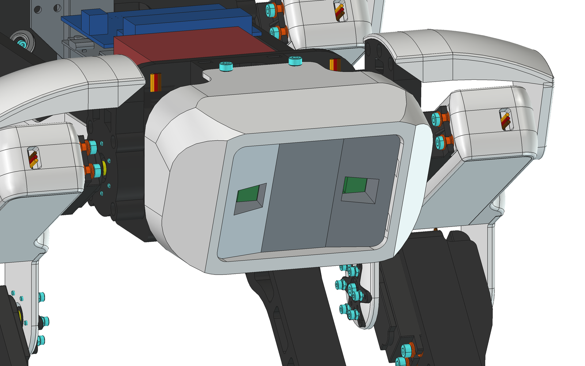

# SpotMicro for Arduino UNO Q

A 3D-printed quadruped robot dog with an [Arduino UNO Q](https://docs.arduino.cc/hardware/uno-q/) brain and two
cameras in its head. The full robot is modelled in FreeCAD, and every part is ready to print.

Built on the work of the Spot Micro community: Kooba's and Michael Kubina's SpotMicroESP32, Rune Harlyk's Leika,
robjk's reinforced shoulders and KDY0523's original Spot Micro. See [docs/background.md](docs/background.md) and
[NOTICE.md](NOTICE.md).


**Print it:** [MakerWorld](https://makerworld.com/en/models/3584508-spotmicro-robot-dog-for-arduino-uno-q) (sliced
projects for the Bambu Lab P1S) · **Buy the parts:** [BOM.md](BOM.md) · **Check fits first:**
[docs/test-prints.md](docs/test-prints.md) · 1080p video: [spot-unoq-explode.mp4](docs/images/spot-unoq-explode.mp4)

## Status

| Area | State |
| ---- | ----- |
| Frame, legs, covers | Modelled and interference-checked; printed parts available |
| Electronics bay | Modelled and interference-checked; not yet printed |
| Cameras | Modelled and interference-checked; not yet printed |
| Firmware | Not started; see [firmware/README.md](firmware/README.md) |

## Electronics bay


One board stack sits at the rear of the plate:

- **Bottom:** [Arduino UNO Media Carrier](https://store-usa.arduino.cc/products/uno-media-carrier), with the two
  camera connectors.
- **Middle:** the UNO Q.
- **Top:** [Adafruit 16-channel servo shield](https://www.adafruit.com/product/1411). Right-angle headers point the
  servo plugs forward, 1.8 mm under the top cover.

In front of the stack is the SZBK07 servo regulator (red). The camera cables (orange) run under it and through the
front shoulder plates to the head.

The carrier has no mounting holes, so the plate holds it with four pads, two fixed hooks (edge opposite the USB-C)
and two snap clips (USB-C edge). Clip the carrier in, then press the UNO Q onto it.

| Clearance | |
| --------- | - |
| Servo plugs to top cover | 1.8 mm |
| SZBK07 to top cover | 4.5 mm |
| Carrier's bottom sockets to plate | 0.95 mm |
| Board stack to battery-cable tunnel | 0.7 mm |
| Servo plugs to SZBK07 | 5.5 mm |

- **Servo wires:** run sideways into the channels beside the SZBK07 (23 mm left, 19 mm right).
- **USB-C:** faces the right side rail, 20 mm away; use a right-angle plug or program over Wi-Fi.
- **Battery lead:** runs under the plate beside the battery and up through the slot at the rear-left corner.

Power, from a 2S LiPo (7.4-8.4 V):

- **UNO Q and Media Carrier:** battery into the UNO Q's VIN (7-24 V).
- **Servos:** SZBK07 at 6.0 V into the shield's V+ terminal. It holds 6.0 V down to about 7.5 V of battery, then
  follows the battery down, still within the servos' rating.
- **I2C:** the shield's PCA9685 and the GY-521 IMU.

All positions and sizes are in the `Params` spreadsheet of `cad/UnoQ_Mountingplate.FCStd`:

- **Stack:** `Carrier_X0`, `Carrier_Y0`, `Standoff_H`, `Standoff_D`.
- **Clips:** `Clip_W`, `Clip_Gap`, `Hook_T`, `Hook_Lip`, `Snap_T`, `Snap_Lip`, `Lip_H`.
- **SZBK07:** `Buck_CX`, `Buck_CY`, `Buck_SX`, `Buck_SY`, `Buck_H`, `Buck_Post_D`, `Buck_Screw_D`.

## Cameras



Two Raspberry Pi Camera Module 2s (IMX219, the sensor the Media Carrier supports) sit 47 mm apart and face the same
way, for stereo. Each screws to the back of the head mount (`cad/Sensormount_DualCam.FCStd`) with four M2 screws. Its
lens window is flared to clear the 62° × 49° field of view.

The cables are **Standard–Mini, 200 mm**; the cable in the camera box doesn't fit the carrier. The modelled routes
(`FPC_left`, `FPC_right`) use about 172 mm, leaving about 28 mm to fold flat in the shoulder box. The connector
nearer the carrier's USB-C edge goes to the right camera.

Camera dimensions are in the mount's `Params` spreadsheet. Check `Cam_Lens_From_Top` (9.46 mm) on the first print:
it comes from published figures, not an official drawing.

## Reinforced shoulders


Each upper leg pivots on two supports: the servo shaft, and a 625ZZ bearing in a shoulder cover bolted to an
extended servo cap. In the assembly the bearing bore is on the servo axis to within 0.3 mm on all four legs.

## Repository layout

```
cad/
  SpotUnoQ.FCStd              full assembly (links Kubina's assembly for the mechanical parts)
  UnoQ_Mountingplate.FCStd    electronics plate (parametric)
  Sensormount_DualCam.FCStd   camera head mount (parametric)
  UnoQ_board.FCStd            UNO Q model, built by scripts/fetch-references.sh (not committed)
  MediaCarrier_board.FCStd    Media Carrier model, built by scripts/fetch-references.sh (not committed)
stl/                          every printable part, with quantities (stl/README.md)
step/                         STEP versions of the parts that have FreeCAD sources
docs/                         fit tests, background, ideas, renders
firmware/                     firmware notes
scripts/                      exports, MakerWorld build, animation, reference fetch
reference/                    downloaded third-party CAD (not committed)
```

## Working with the CAD

Requires [FreeCAD](https://www.freecad.org/) 1.1 or later. To print, you only need [`stl/`](stl/README.md).

```sh
scripts/fetch-references.sh
```

This downloads Kubina's assembly and Arduino's UNO Q and Media Carrier models, and builds the two board files. It
expects FreeCAD at `/Applications/FreeCAD.app`; set `FREECADCMD` otherwise. Then open `cad/SpotUnoQ.FCStd` and allow
FreeCAD to open the linked documents.

### Regenerating STLs and STEPs

Download the upstream files by hand (Thingiverse blocks scripts): [thing:4559827](https://www.thingiverse.com/thing:4559827)
(three zips) into `reference/kooba/`, [thing:4937631](https://www.thingiverse.com/thing:4937631) into `reference/robjk/`.

```sh
FREECADCMD=/Applications/FreeCAD.app/Contents/Resources/bin/freecadcmd
$FREECADCMD scripts/export_stls.py    # stl/, plus STEPs of the plate and camera mount
$FREECADCMD scripts/export_steps.py   # step/ for the upstream parts
```

`export_steps.py` fits each FreeCAD solid to its STL and skips any part more than 0.1 mm off (95th percentile).
robjk's extended servo mount and M3 bearing pin have no STEP, since they exist only as STL.

### MakerWorld projects

```sh
python3 scripts/build_makerworld_3mf.py --no-orient                # makerworld/SpotUnoQ_P1S.3mf
python3 scripts/build_makerworld_3mf.py --no-orient --test-prints  # makerworld/SpotUnoQ_P1S_test_prints.3mf
```

| Project | Plates | Time | Filament |
| ------- | ------ | ---- | -------- |
| Full robot | 10, one filament each (black PLA, white PLA, TPU feet) | 32 h | 1.2 kg |
| Fit tests | 2 (black, white) | 2.8 h | 84 g |

Both are sliced for the P1S (0.4 mm nozzle, 0.20 mm Standard, Textured PEI) with 3 walls on structural plates, 100%
infill on the covers and 20% elsewhere. The script stops on any part that misses its plate or any slicer warning.
`--no-orient` keeps `Top_Cover_Split_Rear_with_OLED` from being auto-oriented into a position that needs supports.

### Exploded-view animation

`scripts/explode_animation.FCMacro` renders the loop above and encodes the MP4 and GIF with ffmpeg
(`brew install ffmpeg`). Run it in the FreeCAD GUI with the assembly open (Macro → Macros… → Execute), or from the
Python console:

```python
exec(open("/path/to/spotmicro-arduino-q/scripts/explode_animation.FCMacro").read())
```

Settings are at the top of the file. It restores every part afterwards and doesn't save.

### Coordinate frame

The plate, cover and head files share a body frame: +Y toward the head, +X to the robot's right, plate top at
Z = 5 mm. In the assembly it is Kubina's `Chassis All` placement times a (55, 0, -9.75) mm translation.

### Driving FreeCAD from Claude Code

`.mcp.json` registers the [freecad-mcp](https://github.com/neka-nat/freecad-mcp) server, so Claude Code can edit and
render the CAD in a running FreeCAD. Setup on macOS:

1. Install FreeCAD and uv:

   ```sh
   brew install --cask freecad
   brew install uv
   ```

2. Install the FreeCAD addon. Create `Mod` first, or `cp -r` puts the addon's contents in the wrong folder:

   ```sh
   git clone https://github.com/neka-nat/freecad-mcp.git /tmp/freecad-mcp
   mkdir -p ~/Library/Application\ Support/FreeCAD/v1-1/Mod
   cp -r /tmp/freecad-mcp/addon/FreeCADMCP ~/Library/Application\ Support/FreeCAD/v1-1/Mod/
   ```

   Other platforms use other folders; see the addon's
   [installation guide](https://github.com/neka-nat/freecad-mcp/blob/main/docs/installation.md#addon-directory).

3. Optional: start the addon's server (127.0.0.1 only) with FreeCAD:

   ```sh
   echo '{"remote_enabled": false, "allowed_ips": "127.0.0.1", "auto_start_rpc": true, "auth_token": ""}' \
     > ~/Library/Application\ Support/FreeCAD/v1-1/freecad_mcp_settings.json
   ```

   Otherwise, pick the **MCP Addon** workbench and click **Start RPC Server** each time.

4. Open FreeCAD; the Report view shows the server on `127.0.0.1:9875`.

5. Start Claude Code in this repository and approve the `freecad` server. `/mcp` shows the connection and reconnects
   it if FreeCAD started later.

Heavy mesh booleans through the server can crash FreeCAD; the scripts run headless with `freecadcmd` instead.

## License

- Code (scripts, firmware): MIT, see [LICENSE](LICENSE).
- Hardware and documentation (CAD in `cad/`, renders, docs): CC BY-SA 4.0, see [LICENSE-HARDWARE](LICENSE-HARDWARE).

Third-party parts keep their own licenses; see [NOTICE.md](NOTICE.md). Most of `stl/` is Kooba's and robjk's work
(CC BY), and Kubina's assembly (GPL-3.0) is fetched, not redistributed.
