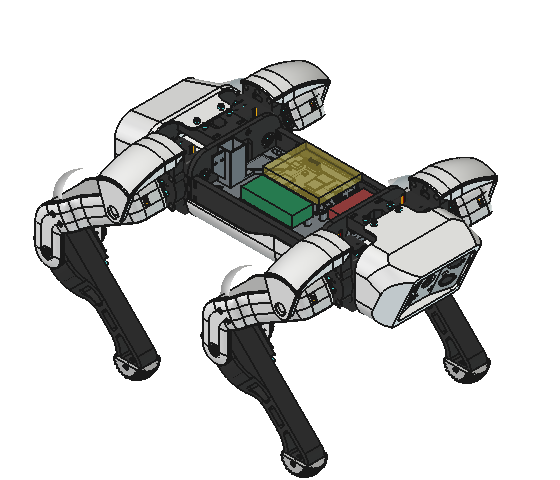
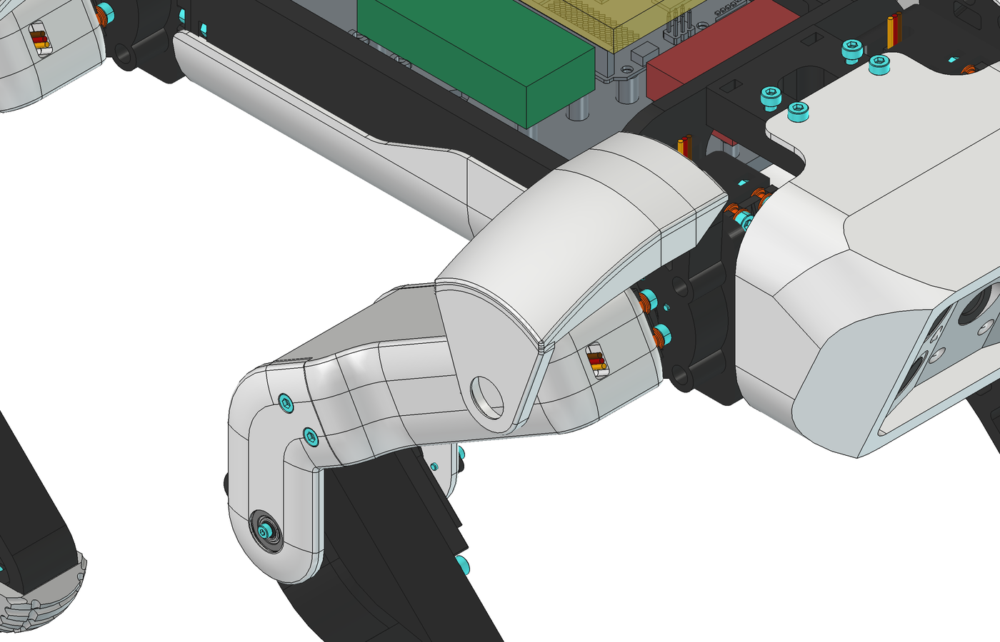
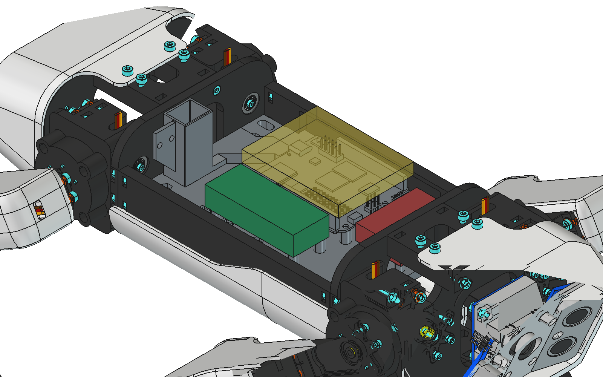

# spot-unoq

A Spot Micro quadruped built around the [Arduino UNO Q](https://docs.arduino.cc/hardware/uno-q/) instead of an ESP32.
It is a port of [SpotMicroESP32-Leika](https://github.com/runeharlyk/SpotMicroESP32-Leika), which uses Michael Kubina's
[SpotMicroESP32](https://github.com/michaelkubina/SpotMicroESP32) printed parts, which in turn derive from KDY0523's
original [Spot Micro](https://www.thingiverse.com/thing:3445283).



## Status

| Area | State |
| ---- | ----- |
| Mechanical (frame, legs, covers, head) | SpotMicroESP32, with robjk's reinforced shoulders, in the CAD assembly and the STLs |
| Electronics bay | New mounting plate for the UNO Q, PCA9685, GY-521 and a Pololu 6 V 15 A regulator. Interference-checked in the full assembly. Not yet printed. |
| Firmware | Not started. See [firmware/README.md](firmware/README.md). |
| Head camera mount | Still the ESP32-CAM mount; needs a redesign for a USB or MIPI-CSI camera |

## Reinforced shoulders



robjk's shoulder cover bolts to an extended servo cap and carries a 625ZZ bearing on the outside of the upper leg, so
each leg pivots on two supports instead of hanging on the servo shaft. In `cad/SpotUnoQ.FCStd` the parts are in the
`Reinforced_Shoulders_robjk` group, fitted to Kubina's assembly: the cover's bearing bore is on the shoulder servo axis to
within 0.3 mm on all four legs, and the covers and leg shells don't collide with anything.

## Electronics bay



The UNO Q sits middle-left on four 8 mm standoffs, USB-C facing the rear. The standoffs clear the two bottom
connectors (JMISC, JMEDIA), which hang 5 mm below the board. Green is the PCA9685, red is the servo regulator,
yellow is an 8 mm space reserved above the UNO Q headers for plugged-in wires.

Clearances in the assembly: UNO Q to top cover 7.9 mm, wiring space to top cover 3.4 mm, UNO Q to side rails 4.4 mm,
regulator to UNO Q 5.8 mm.

Power, from a 2S LiPo (7.4-8.4 V):

- **UNO Q:** straight from the battery into VIN (7-24 V). The ESP32 build's LM2596 5 V buck is gone.
- **Servos:** Pololu D24V150F6 at 6 V, through the PCA9685's V+ terminal.
- **Logic:** PCA9685 and IMU on the UNO Q's 3.3 V I2C (UNO header A4/A5 or Qwiic).

Positions, standoff heights, hole sizes and the regulator hole spacing are all in the `Params` spreadsheet in
`cad/UnoQ_Mountingplate.FCStd`. If you use a different regulator, change `Buck_SX`, `Buck_SY` and `Buck_Screw_D`.

Parts and buy links are in [BOM.md](BOM.md). Optional sensors and changes not yet in the BOM are in
[docs/ideas.md](docs/ideas.md).

## Repository layout

```
cad/
  SpotUnoQ.FCStd              full assembly: Kubina's assembly (linked), robjk's shoulders, the new electronics
  UnoQ_Mountingplate.FCStd    new electronics plate (parametric, PartDesign)
  UnoQ_board.FCStd            UNO Q model, built by scripts/fetch-references.sh (not committed)
  export/                     STEP of the new plate
stl/                          every printable part, with quantities (stl/README.md)
step/                         the same parts as STEP, from the designers' FreeCAD sources (see below)
docs/images/                  renders
firmware/                     placeholder for the Leika port
scripts/                      fetch third-party CAD, build the board model
reference/                    downloaded third-party CAD (not committed)
```

## Getting started

Requires [FreeCAD](https://www.freecad.org/) 1.1 or later.

```sh
scripts/fetch-references.sh
```

This downloads Kubina's assembly and Arduino's UNO Q model, and builds `cad/UnoQ_board.FCStd`. On macOS it expects
FreeCAD at `/Applications/FreeCAD.app`; set `FREECADCMD` otherwise.

Then open `cad/SpotUnoQ.FCStd`. FreeCAD asks to open the linked documents; allow it.

To print, you only need [`stl/`](stl/README.md).

To regenerate `stl/` (for example after changing the plate), you also need Kooba's and robjk's original files.
Thingiverse blocks scripted downloads, so download them by hand with "Download all files" and unzip them:
[thing:4559827](https://www.thingiverse.com/thing:4559827) (three zips) into `reference/kooba/`, and
[thing:4937631](https://www.thingiverse.com/thing:4937631) into `reference/robjk/`. Then run:

```sh
/Applications/FreeCAD.app/Contents/Resources/bin/freecadcmd scripts/export_stls.py
```

### STEP files

`step/` mirrors `stl/` with STEP versions of every part that has a FreeCAD source: Kooba's parts, robjk's shoulder
cover, extended cap, upper-leg shell and medium rear cover, and this project's electronics plate (in `cad/export/`).
Each solid is fitted to its STL so the two match in print orientation and position; the script refuses any part whose
STL surface lies more than 0.1 mm from the STEP (95th percentile). robjk's extended servo mount and M3 bearing pin
exist only as STL upstream.

```sh
/Applications/FreeCAD.app/Contents/Resources/bin/freecadcmd scripts/export_steps.py
```

### MakerWorld project

```sh
python3 scripts/build_makerworld_3mf.py --no-orient
```

writes `makerworld/SpotUnoQ_P1S.3mf`: a sliced Bambu Studio project for the P1S (0.4 mm nozzle, 0.20 mm Standard),
10 plates, one filament each (Bambu PLA Basic black and white, Bambu TPU 95A HF), auto-arranged plate by plate, with
100% infill on the covers and 20% elsewhere. The script stops if any part fails to land on its plate or Bambu Studio
reports a slicing warning. Without `--no-orient` it also auto-orients every part, which lays
`Top_Cover_Split_Rear_with_OLED` down in a position that needs supports.

Add `--test-prints` for `makerworld/SpotUnoQ_P1S_test_prints.3mf`: a 2-hour, 62 g fit test to print before the robot.
One black plate has the UNO Q standoffs and the Pololu regulator posts (cut from the electronics plate onto a thin
frame), a shoulder servo mount, an extended servo cap, an upper-leg bearing mount and one of each bearing pin; one white
plate has a shoulder cover. See [docs/test-prints.md](docs/test-prints.md) for what to check and what to change if
something doesn't fit.

### Coordinate frame

The plate and cover files share a body frame: +Y toward the head, +X to the robot's right, plate top at Z = 5 mm,
side rails centered at Z ≈ 10 mm. In the assembly that frame is Kubina's `Chassis All` placement multiplied by a
translation of (55, 0, -9.75) mm.

### Driving FreeCAD from Claude Code

`.mcp.json` registers the [freecad-mcp](https://github.com/neka-nat/freecad-mcp) server for this project, so Claude
Code can open, edit and render the CAD in a running FreeCAD while you watch. It has two halves: an addon that runs
inside FreeCAD and listens on `127.0.0.1:9875`, and an MCP server that Claude Code starts with `uvx`. Setup on macOS:

1. **Install FreeCAD 1.1 and uv** (uv provides `uvx`, which runs the MCP server):

   ```sh
   brew install --cask freecad
   brew install uv
   ```

2. **Install the FreeCAD addon.** Create the `Mod` folder first; if it doesn't exist, `cp -r` copies the addon's
   contents into a new folder named `Mod` instead of into `Mod/FreeCADMCP`, and FreeCAD won't find it.

   ```sh
   git clone https://github.com/neka-nat/freecad-mcp.git /tmp/freecad-mcp
   mkdir -p ~/Library/Application\ Support/FreeCAD/v1-1/Mod
   cp -r /tmp/freecad-mcp/addon/FreeCADMCP ~/Library/Application\ Support/FreeCAD/v1-1/Mod/
   ```

   The result should be `~/Library/Application Support/FreeCAD/v1-1/Mod/FreeCADMCP/InitGui.py`. Other platforms and
   FreeCAD versions use other folders; see the addon's
   [installation guide](https://github.com/neka-nat/freecad-mcp/blob/main/docs/installation.md#addon-directory).

3. **Start the addon's server with FreeCAD** (optional, saves a click every launch). It only listens on 127.0.0.1:

   ```sh
   echo '{"remote_enabled": false, "allowed_ips": "127.0.0.1", "auto_start_rpc": true, "auth_token": ""}' \
     > ~/Library/Application\ Support/FreeCAD/v1-1/freecad_mcp_settings.json
   ```

   Without this, choose the **MCP Addon** workbench in FreeCAD and click **Start RPC Server** each time.

4. **Open FreeCAD** (quit and reopen it if it was running when you installed the addon). The Report view should show
   the server listening on `127.0.0.1:9875`.

5. **Start Claude Code in this repository** and approve the `freecad` server from `.mcp.json` when asked. Run `/mcp`
   to check that it's connected. If FreeCAD wasn't running when Claude Code started, reconnect it from `/mcp`.

Claude Code only reaches FreeCAD while FreeCAD is open with the addon's server running. Heavy mesh operations through
the server (for example booleans on large STLs) can crash FreeCAD; the scripts in `scripts/` run headless with
`freecadcmd` instead and don't need the addon.

## License

- Code (scripts, firmware): MIT, see [LICENSE](LICENSE).
- Hardware and documentation (CAD in `cad/`, renders, docs): CC BY-SA 4.0, see [LICENSE-HARDWARE](LICENSE-HARDWARE).

Third-party work keeps its own license; see [NOTICE.md](NOTICE.md). Most files in `stl/` are Kooba's and robjk's
parts (CC BY) and the helper stand (CC BY 4.0 and MIT). In particular, Kubina's assembly is GPL-3.0 and is
fetched rather than redistributed.
