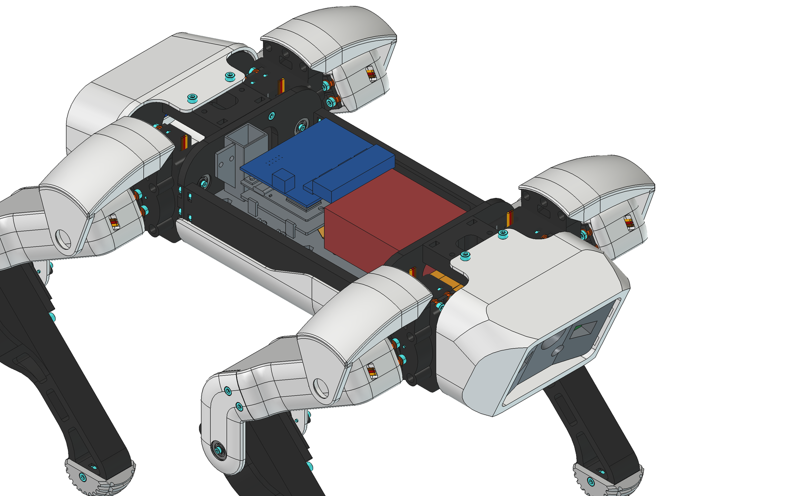
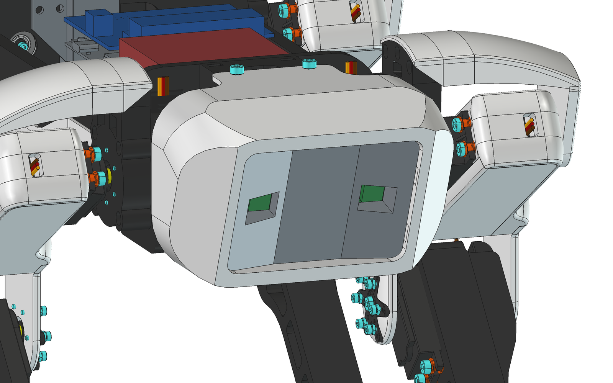

# Variant: UNO Media Carrier, servo shield and two cameras

This variant changes the electronics of the standard build:

- The PCA9685 breakout becomes the **Adafruit 16-channel servo shield** (#1411), stacked on the UNO Q.
- The Pololu D24V150F6 becomes the cheaper, more common **SZBK07** 20 A buck.
- The two HC-SR04 ultrasonic sensors become **two Raspberry Pi Camera Module 2s**, in about the same place in the head.
- The cameras plug into an **Arduino UNO Media Carrier** (ASX00083) under the UNO Q.

Only two printed parts change. Everything else (chassis, legs, shoulders, covers) is the same as the standard build.





## Printed parts

| Print this | Instead of |
| ---------- | ---------- |
| [`stl/variants/media-carrier-cameras/electronics/MediaCarrier_Mountingplate.stl`](../stl/variants/media-carrier-cameras/electronics/MediaCarrier_Mountingplate.stl) | `stl/electronics/UnoQ_Mountingplate.stl` |
| [`stl/variants/media-carrier-cameras/head/Sensormount_DualCam.stl`](../stl/variants/media-carrier-cameras/head/Sensormount_DualCam.stl) | `stl/head/Sensormount.stl`, `stl/head/Cameramount_ESP32_CAM.stl` and `stl/head/Cameramount_ESP32_CAM_Counterpiece.stl` |

STEP files for both are in `step/variants/media-carrier-cameras/`. The FreeCAD sources are
`cad/MediaCarrier_Mountingplate.FCStd` and `cad/Sensormount_DualCam.FCStd`, and the full assembly is
`cad/SpotUnoQ_MediaCarrier.FCStd`.

### Fit tests

Print these before the plate. They're cut straight from it, so they check the real geometry.

| File | Check |
| ---- | ----- |
| [`Carrier_Mount_Test.stl`](../stl/variants/media-carrier-cameras/test-prints/Carrier_Mount_Test.stl) | Hook the Media Carrier's edge (the one opposite the USB-C) under the two fixed hooks, then press the USB-C edge down until the two snap clips click over it. It should sit flat on the four pads, with no rocking and no force on its bottom sockets. |
| [`SZBK07_Mount_Test.stl`](../stl/variants/media-carrier-cameras/test-prints/SZBK07_Mount_Test.stl) | The SZBK07's four holes line up with the posts, and M3x8 screws bite into the 2.6 mm pilot holes. |

`Sensormount_DualCam` is a small print, so it's its own fit test. Each Camera Module 2 should sit flat on the back of the
mount with its lens in the window, held by four M2x5 self-tapping screws.

## Hardware changes

| Remove | Add |
| ------ | --- |
| PCA9685 breakout (Adafruit 815) | 1× [Adafruit 16-channel 12-bit PWM/Servo Shield, #1411](https://www.adafruit.com/product/1411). Solder it with the plain male header strip that comes with it, not stacking headers. |
| The four straight 3×4 servo headers that come with the shield | 1× [Adafruit right-angle 3×4 header 4-pack, #816](https://www.adafruit.com/product/816). The servo plugs then lie flat and point forward, staying under the top cover. |
| Pololu D24V150F6 | 1× SZBK07 20 A step-down module, 60 × 54 × 28 mm, holes 39 × 53.5 mm ([search](https://www.amazon.com/s?k=SZBK07+20A+buck)). Set it to 6.0 V before connecting servos. |
| 2× HC-SR04 | 2× Raspberry Pi Camera Module 2 (IMX219; [Adafruit 3099](https://www.adafruit.com/product/3099)) |
| - | 1× [Arduino UNO Media Carrier, ASX00083](https://store-usa.arduino.cc/products/uno-media-carrier) |
| - | 2× Raspberry Pi camera cable, **Standard–Mini, 200 mm** ([Adafruit 5818](https://www.adafruit.com/product/5818)). The cable in the camera box is Standard–Standard and doesn't fit the carrier. |
| - | 8× M2x5 self-tapping screws (cameras), 4× M3x8 (SZBK07) |

The Media Carrier officially supports IMX219 cameras only, which is why this uses Camera Module 2 and not Camera Module 3.

## Layout

The board stack (carrier, UNO Q, shield) sits at the rear of the plate. Its front edge faces the head; that edge has the
two camera connectors (underneath the carrier) and the servo headers (on top of the shield). The SZBK07 sits between
the stack and the head.

- **Carrier mount:** the Media Carrier has no mounting holes; it hangs from the UNO Q's connectors. The plate holds it
  instead: four pads under the bare middle of its underside, two fixed hooks on the edge opposite the USB-C, and two
  snap clips on the USB-C edge. Clip the carrier in first, then press the UNO Q onto it; the pads take the pressing
  force.
- **Servo plugs:** with right-angle headers the plugs point forward, 5.5 mm short of the SZBK07. Run the servo wires
  sideways to the left and right channels next to the SZBK07: 23 mm wide on the left, 19 mm on the right.
- **USB-C:** the UNO Q's USB-C port faces the right side rail, 20 mm away, so use a right-angle USB-C plug (the
  optional right-angle extension in the BOM), or program the UNO Q over Wi-Fi.
- **Battery lead:** the standard plate's raised power-cable cap is removed, so the plate is flat at the rear. Run the
  XT60 lead along the left side of the battery, under the plate (the space beside the LiPo brackets is about
  20 × 24 mm), and up through Kooba's existing connector slot at the rear-left corner.

Clearances measured in `cad/SpotUnoQ_MediaCarrier.FCStd` (the boards are Arduino's STEP models; the shield, SZBK07 and
cameras are dimensioned placeholders):

| Between | Clearance |
| ------- | --------- |
| Servo plugs and the top cover | 1.8 mm |
| SZBK07 and the top cover | 4.5 mm |
| Media Carrier bottom sockets and the plate | 0.95 mm |
| Board stack and the battery-cable tunnel (rear) | 0.7 mm |
| Camera boards and the front cover | 1.0 mm |

## Camera cables

Both cables run flat on the plate from the carrier's front edge, under the SZBK07 between its posts. They go through
the 36 × 40 mm windows in the front shoulder plates, then fold sideways just behind the head and run up to the connectors on the bottom edges of the cameras.
The routes are modelled in the assembly (orange, `FPC_left` and `FPC_right`) and clear everything. Each uses about
172 mm, so the **200 mm** cable leaves about 28 mm of slack. Fold that slack flat in the shoulder box.

The SZBK07 sits on 5 mm posts, leaving about 3 mm between the cables and its solder joints. Put a strip of Kapton
tape on the cables where they pass under it.

Each cable goes straight to the camera on its side: the connector nearer the USB-C edge to the right camera, the
other to the left. Map CSI0/CSI1 to left/right in software.

## The camera mount

`Sensormount_DualCam` is Kooba's sensor mount with the two HC-SR04 hole pairs filled in and these features added:

- A recess on the back for each camera's lens module and connector (2.2 mm deep).
- Four M2 pilot holes per camera on the 21 × 12.5 mm pattern.
- A lens window that opens towards the front to clear the camera's full 62° × 49° field of view, plus 3° of margin.

The cameras sit 47 mm apart, 3 mm inboard of the old sensors, and both face the same way as the head, so the images
are parallel for stereo. Kooba's central ESP32-CAM lens and flash openings are filled in, so the front has only the
two camera windows.

Every camera dimension is in the `Params` spreadsheet in `cad/Sensormount_DualCam.FCStd`:

- **Board and hole pattern:** `Cam_Board_W`, `Cam_Board_H`, `Cam_Hole_SX`, `Cam_Hole_SY`, `Cam_Hole_Inset`.
- **Lens position:** `Cam_Lens_From_Top`.
- **Spacing:** `Cam_X`.
- **Window flare:** `Cam_Half_FOV_H`, `Cam_Half_FOV_V`, `Cam_Pupil_Depth`.

The lens position (9.46 mm below the top edge) uses commonly cited Camera Module 2 figures that I haven't checked
against an official drawing. Check it on the first print, and change `Cam_Lens_From_Top` if the lens isn't centred in
its window.

## Plate parameters

Everything in `cad/MediaCarrier_Mountingplate.FCStd` is driven by its `Params` spreadsheet:

- **Stack position:** `Carrier_X0`, `Carrier_Y0`.
- **Carrier pads:** `Standoff_H`, `Standoff_D`.
- **Clips:** `Clip_W`, `Clip_Gap`, `Hook_T`, `Hook_Lip`, `Snap_T`, `Snap_Lip`, `Lip_H`.
- **SZBK07:** `Buck_CX`, `Buck_CY`, `Buck_SX`, `Buck_SY`, `Buck_H`, `Buck_Post_D`, `Buck_Screw_D`.

After changing anything, regenerate the STLs and STEPs:

```sh
/Applications/FreeCAD.app/Contents/Resources/bin/freecadcmd scripts/export_stls.py
```

`scripts/fetch-references.sh` downloads Arduino's Media Carrier STEP and builds `cad/MediaCarrier_board.FCStd`, which
the variant assembly links. It isn't committed, for the same licensing reason as the UNO Q model.

## Power

The SZBK07 needs about 1-2 V of headroom, so with a 2S pack it holds 6.0 V down to roughly 7.5 V. Below that the servo
rail follows the battery down. This is similar to the Pololu, and still inside the servos' rating. The UNO Q still runs
from the battery through VIN. The Media Carrier is powered through the UNO Q's connectors.
